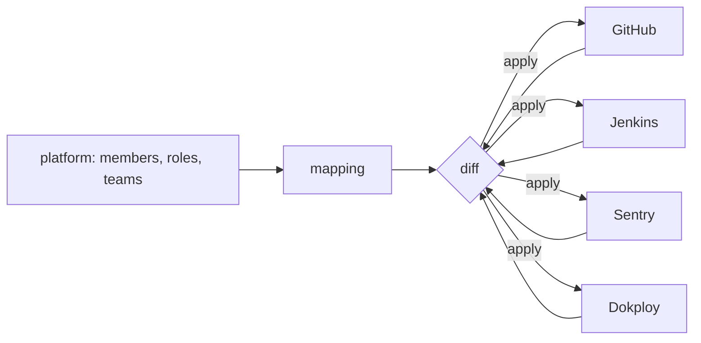

# apx-access

Access for [Action Platform](https://github.com/actionplatform/action-platform): the members, teams and roles of an organization on the platform, mapped onto the services the team uses. Who has what, where it drifted, and one call to give, take or remove access everywhere.

| Service | What it reads and changes | Account |
|---|---|---|
| GitHub | organization membership and role, team membership, repository permissions of people and of teams | login |
| Jenkins | Role-based Authorization Strategy: a global role (`read`, `admin`) and one item role per folder and level (`read`, `build`, `configure`) | user id |
| Sentry | organization membership and role, team membership and team role | email |
| Dokploy (self-hosted) | organization membership and role, which projects a member may open | email |

## How it works



- **Live state** is read from each service on every call; nothing is cached.
- **The mapping** links each member's email to an account per service and names the grants a platform role (`roles`), a team (`teams`) or one person (`grants`) carries; the access of accounts that belong to no member (bots, agencies) is kept as found (`keep`). It is stored as this plugin's options of the organization on the platform, so everyone who manages access there shares one.
- **A service is imported before it is managed.** The first `access_sync` that reads a service links members to accounts (an account that is the member's email links itself; GitHub logins and Jenkins ids are passed as `links`), records what the service holds today and changes nothing there. A sync right after is a no-op; from then on, a member who leaves the organization, changes team or role, or is granted something shows up as drift. A service that could not be read stays unimported until a later sync reads it.
- **Dry run by default.** Every change answers with the plan; `apply` makes it.
- **Never the last administrator.** A change that would leave a GitHub organization without an admin, Jenkins without a global admin, Sentry without an owner, or touch Dokploy's owner is refused before anything is sent.
- Accounts compare without case.

## Tools and commands

| MCP tool | Command | Does |
|---|---|---|
| `access_who` | `action-platform access who --person <email>` / `--service <name>` | a person's accounts, live grants and drift; or every account on a service and the member it belongs to |
| `access_audit` | `action-platform access audit` | drift per service, members without an account, accounts that belong to no member |
| `access_grant` | `action-platform access grant <email> <service> <resource> <level>` | one grant to one person, recorded in the mapping; only that person's account is touched |
| `access_revoke` | `action-platform access revoke <email> <service> <resource>` | takes it away; says when the role or a team still grants it |
| `access_offboard` | `action-platform access offboard <email>` | every grant of every linked account, the mapping entries, optionally the platform membership |
| `access_sync` | `action-platform access sync` | imports a service the first time; then adds, changes and removes to close the drift |

Resources and levels:

| Service | Resource | Levels |
|---|---|---|
| github | `org` · `team/<slug>` · `repo/<name>` | `member` `admin` · `member` `maintainer` · `pull` `triage` `push` `maintain` `admin` |
| jenkins | `global` · `folder/<name>` | `read` `admin` · `read` `build` `configure` |
| sentry | `org` · `team/<slug>` | `member` `billing` `admin` `manager` `owner` · `contributor` `admin` |
| dokploy | `org` · `project/<name>` | `member` `admin` · `access` |

- A GitHub team grant brings organization membership with it; `access_grant` on a Jenkins folder adds global `read` when the person has no global role, since Jenkins shows nothing without it. A team or role in the mapping that opens a folder lists `global read` itself.
- Roles the plugin did not create stay visible as `global-role/<name>` and `item-role/<name>` (level `assigned`).
- Dokploy admins and owners already see every project, so project grants for them are dropped. An invitation counts as access while it is pending and unexpired. Removing a member calls Dokploy's `user.remove`, which deletes the user on the instance.
- Sentry and Dokploy invite by email; the person accepts before team or project grants can follow on Dokploy.

## Install

```bash
action-platform login https://platform.example.com
action-platform plugin install access
```

The plugin runs where the CLI and its MCP server run (`action-platform mcp`), like every plugin; it reads the organization through the login and each service with its own credential.

## Settings

Each from the environment (`AP_ACCESS_<KEY>`) or the plugin's options file on that machine. A service is on when its organization or URL is set.

| Service | Keys | Credential needs |
|---|---|---|
| platform | `organization` (slug; the token's when empty) | a login whose role has `org.manage` (admin or owner) — the mapping is the organization's plugin options |
| GitHub | `github_org`, `github_token`, `github_url` (Enterprise only) | classic token of an organization owner: `admin:org` and `repo`; `read:org` and `repo` read and change team repository permissions only |
| Jenkins | `jenkins_url`, `jenkins_user`, `jenkins_token` | an administrator's API token; the role-strategy plugin installed and selected under Security |
| Sentry | `sentry_org`, `sentry_token`, `sentry_url` (self-hosted only) | personal token with `member:admin`, `team:write`, `org:read`; `member:read`, `team:read` to read only |
| Dokploy | `dokploy_url`, `dokploy_api_key` | an owner's API key |

Credentials are never written to the mapping and never echoed in an error.

## Develop

```bash
poetry install
poetry run ruff check . && poetry run ruff format --check . && poetry run pytest
AP_ACCESS_LIVE=1 AP_ACCESS_GITHUB_ORG=… AP_ACCESS_GITHUB_TOKEN=… poetry run pytest tests/live   # read-only, against the real services
```

`tests/fake.py` holds each service in memory, answering the routes and fields the real API sends. The contract a plugin follows: [apx-example's SPEC.md](https://github.com/actionplatform/apx-example/blob/master/SPEC.md).
